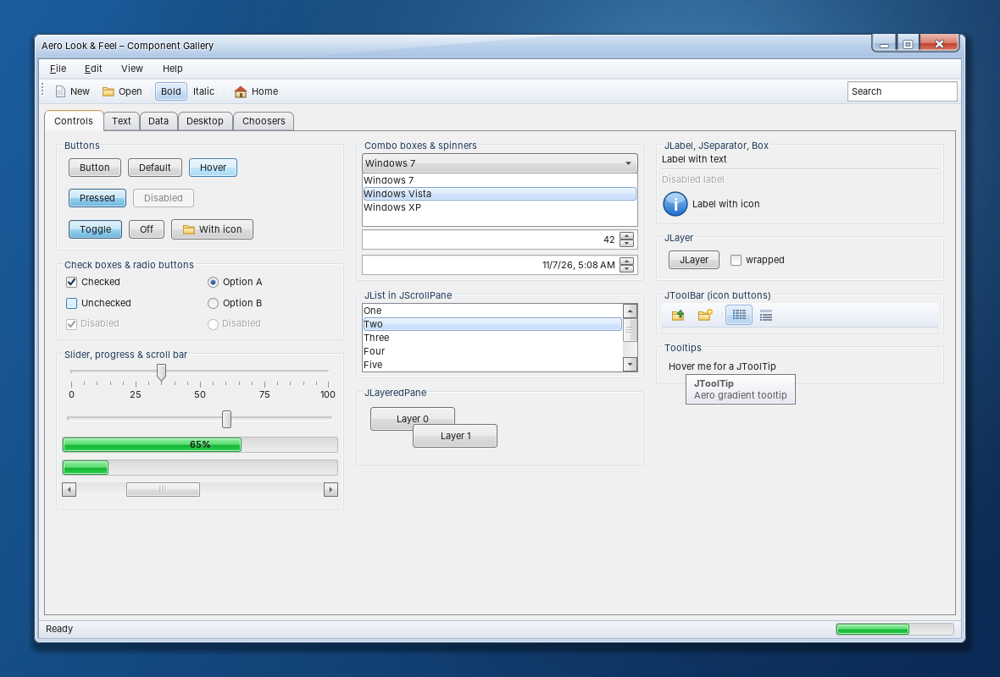
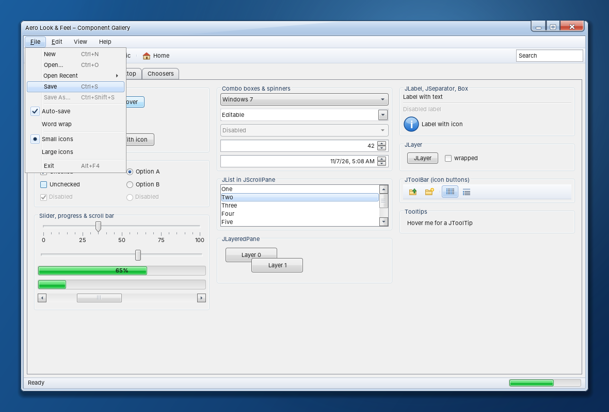
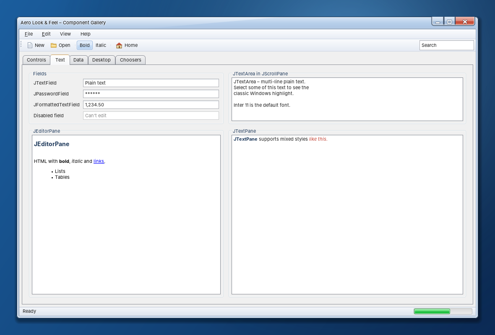
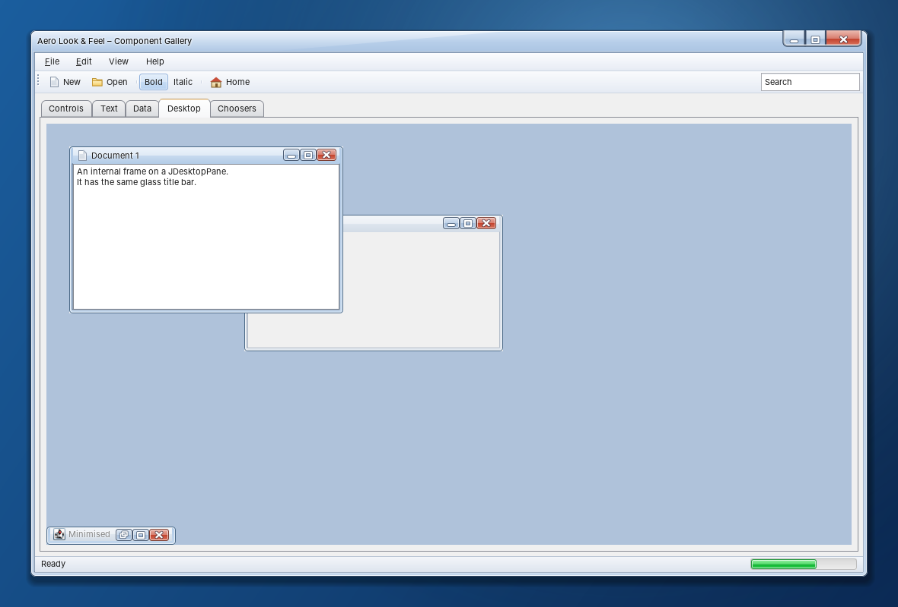
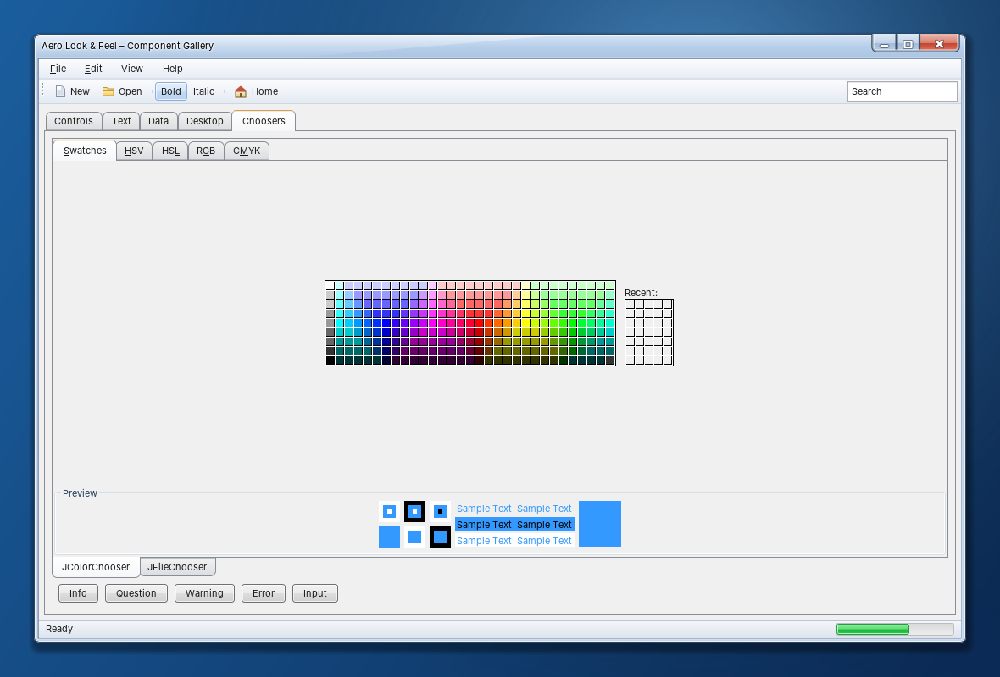

# Aero LAF - Windows Vista Aero Plastic Look Inspired

## Summary

**Aero LAF** is a custom Java Swing **Look and Feel** inspired by the Windows Vista Aero plastic look: glossy, translucent glass-style controls with a distinctive plastic sheen. Use it to give your Swing applications a nostalgic Vista appearance.

## Development Status

#### Note : Vibe Coded, In-Development - Bugs may exist - Use with caution - Report Bugs and Feature Requirements!!!

  

---

## ❤️ Support This Project

If you enjoy using this software, you can support
its continued development!

### 🍕 Buy Me a Pizza  
<a href="https://buymeacoffee.com/sahasrarachakra?l=en">
  
</a>


## If you are an Indian Supporter
### 🇮🇳 Support via UPI

Scan this QR code using Google Pay, PhonePe or Paytm.


Thank you for supporting open-source development!

---

## Screens










## Features

- Swing Look and Feel in the Windows Vista Aero plastic style
- Glossy plastic buttons with named **button styles**
- Custom Aero-style title bar
- Glass-style toolbars, menus and menu bars
- Styled internal frames, tabs, combo boxes, scroll bars and more
- Smooth text anti-aliasing
- Easy one-line installation

## Prerequisites for Running

- This is a **library for Java developers**, not a stand-alone program
- A Java application (Swing) running on **Java 17 or later**

## How to Run

1. Download the latest `Aero-LAF.jar` from the **Releases** page.
2. Add it to your application's classpath (or to the `lib/` folder of your IDE project).
3. Install the look and feel before creating any Swing component:

```java
import javax.swing.UIManager;

public class Demo {
    public static void main(String[] args) throws Exception {
        UIManager.setLookAndFeel("com.jsoft.aerolaf.AeroLookAndFeel");
        javax.swing.SwingUtilities.invokeLater(() -> {
            // create and show your JFrame here
        });
    }
}
```

Or start any existing Swing app with it from the command line:

```bash
java -Dswing.defaultlaf=com.jsoft.aerolaf.AeroLookAndFeel -cp Aero-LAF.jar;yourapp.jar com.example.Main
```

## How to Use

1. Add `aero.jar` to your project libraries (NetBeans: Libraries > Add JAR).
2. First line of `main`:

   ```java
   AeroLookAndFeel.install();        // before creating any window
   ```
   That sets the L&F **and** turns on the custom glass title bar for every JFrame, JDialog and
   JOptionPane (`JFrame.setDefaultLookAndFeelDecorated(true)` is done for you).
3. Run the gallery: `java -jar aero.jar`

Default font is bundled **Inter 11** (falls back to Segoe UI / SansSerif). Change size: `-Daero.fontSize=12`.
Inter is licensed under the SIL OFL; keep its license file if you redistribute the fonts.


- **Install:** call `UIManager.setLookAndFeel("com.jsoft.aerolaf.AeroLookAndFeel")` once, at startup, before building the UI.
- **Button styles:** select a button style by name using a client property, for example:

```java
button.putClientProperty("JButton.style", "primary"); // primary, standard, error, success ...
```

- **Custom title bar:** enable it with `JFrame.setDefaultLookAndFeelDecorated(true);` before creating your frame.
- **Everything else:** standard Swing components (menus, toolbars, tables, trees, tabs, combo boxes, internal frames, etc.) pick up the look automatically.

<!-- Replace the class name and property keys above with the real ones from your source. -->

## Prerequisites for Building

- **JDK 17 or later**
- An IDE (NetBeans / IntelliJ IDEA / VSCodium) or the command line
- Git

## How to Build

1. Clone the repository:

```bash
git clone https://github.com/<your-username>/<repository-name>.git
cd <repository-name>
```

2. **Using an IDE:** open the project in NetBeans (or IntelliJ IDEA / VSCodium with Java extensions), make sure the project JDK is 17+, add the libraries from the `lib/` folder to the classpath, then choose **Run / Build**.

3. **Using the command line:**

```bash
# Windows (use ':' instead of ';' on Linux/macOS)
mkdir out
javac -cp "lib/*" -d out -sourcepath src src/com/jsoft/laf/DemoApp.java
jar cfe Aero-LAF.jar DemoApp -C out .
```

> Adjust the main class and paths above to match your project layout. Copy any resource folders (fonts, images, `.properties` themes) into the output before packaging, if your IDE does not do this automatically.


## Extras
* `b.putClientProperty("Aero.style", "toolbar")` – flat toolbar-style button outside a JToolBar.
* Title bar: drag to move, double-click maximize, right-click system menu, 6 px resize border, rounded
  corners where the OS supports per-pixel translucency (square otherwise).
* Everything is vector-drawn; no image files except the fonts.

## Layout
`src/aero/*` L&F source, `res/aero/fonts` Inter, `shots/` preview renders (made headless by `aero.Screenshot`).


## Copyright

© JSoft Bharath, Kerala, India & Jeevan Kumar Vishwakarman. All rights reserved.

**Aero LAF - Windows Vista Aero Plastic Look Inspired Developed By : JSoft Bharath, Kerala, India. / Jeevan Kumar Vishwakarman. All Rights Reserved To : JSoft Bharath, Kerala, India. / Jeevan Kumar Vishwakarman.**

## License

**Attribution-Required, No-Modification, No-Resale License**

Copyright © JSoft Bharath, Kerala, India & Jeevan Kumar Vishwakarman ("the Authors").

Permission is hereby granted, free of charge, to any person or organization obtaining a copy of this software and its source code ("the Software") to **use** the Software, for personal or commercial purposes, subject to the following conditions:

1. **Attribution is compulsory.** Any use of the Software, in any application, product, service, documentation or website, must display the following attribution text, in bold, in a place reasonably visible to users (for example an About dialog, credits screen, README or product page):

   **Aero LAF - Windows Vista Aero Plastic Look Inspired Developed By : JSoft Bharath, Kerala, India. / Jeevan Kumar Vishwakarman. All Rights Reserved To : JSoft Bharath, Kerala, India. / Jeevan Kumar Vishwakarman.**

2. **No modification.** You may not change, modify, adapt, translate, decompile, reverse-engineer or create derivative works of the Software's code or binaries. The Software must be used exactly as distributed by the Authors.

3. **No selling or charging for the Software.** You may not sell, rent, sublicense, or charge any fee for the Software or its code, in whole or in part, or bundle it in a way that charges for the Software itself. You **may** charge for your own applications, products and services that use the Software, provided the Software itself is not what is being sold and condition 1 is met.

4. **Redistribution.** You may redistribute the unmodified Software free of charge only if this license, the copyright notice and the attribution text are kept intact.

5. **Ownership.** The Software is licensed, not sold. All rights not expressly granted are reserved by the Authors.

6. **Termination.** Any breach of these terms automatically terminates your rights under this license.

THE SOFTWARE IS PROVIDED "AS IS", WITHOUT WARRANTY OF ANY KIND, EXPRESS OR IMPLIED, INCLUDING BUT NOT LIMITED TO THE WARRANTIES OF MERCHANTABILITY, FITNESS FOR A PARTICULAR PURPOSE AND NONINFRINGEMENT. IN NO EVENT SHALL THE AUTHORS BE LIABLE FOR ANY CLAIM, DAMAGES OR OTHER LIABILITY, WHETHER IN AN ACTION OF CONTRACT, TORT OR OTHERWISE, ARISING FROM, OUT OF OR IN CONNECTION WITH THE SOFTWARE OR THE USE OR OTHER DEALINGS IN THE SOFTWARE.

For permission requests beyond these terms, contact the Authors via the repository's Issues page.
