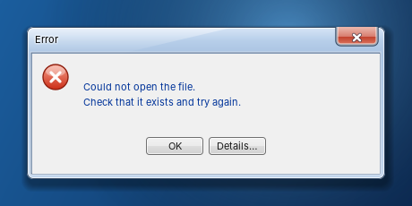
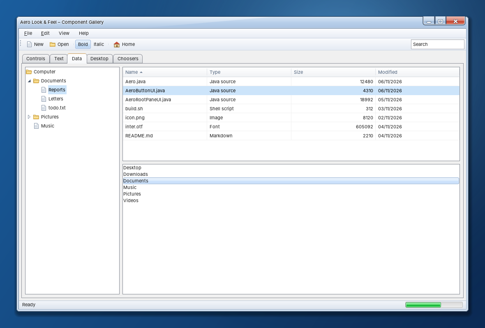

# Aero Look & Feel v3 for Swing (Windows 7 style, Inter 11)

#### Note : Vibe Coded, In-Development - Bugs may exist - Use with caution - Report Bugs and Feature Requirements!!!
    

## ❤️ Support This Project

If you enjoy using this software, you can support
its continued development!

### 🍕 Buy Me a Pizza  
<a href="https://buymeacoffee.com/sahasrarachakra?l=en">
  
</a>


## If you are an Indian Supporter
### 🇮🇳 Support via UPI

Scan this QR code using Google Pay, PhonePe or Paytm.


Thank you for supporting open-source development!


### Screens 








## Use it
1. Add `aero.jar` to your project libraries (NetBeans: Libraries > Add JAR).
2. First line of `main`:
   ```java
   AeroLookAndFeel.install();        // before creating any window
   ```
   That sets the L&F **and** turns on the custom glass title bar for every JFrame, JDialog and
   JOptionPane (`JFrame.setDefaultLookAndFeelDecorated(true)` is done for you).
3. Run the gallery: `java -jar aero.jar`

Default font is bundled **Inter 11** (falls back to Segoe UI / SansSerif). Change size: `-Daero.fontSize=12`.
Inter is licensed under the SIL OFL; keep its license file if you redistribute the fonts.

## Extras
* `b.putClientProperty("Aero.style", "toolbar")` – flat toolbar-style button outside a JToolBar.
* Title bar: drag to move, double-click maximize, right-click system menu, 6 px resize border, rounded
  corners where the OS supports per-pixel translucency (square otherwise).
* Everything is vector-drawn; no image files except the fonts.

## Layout
`src/aero/*` L&F source, `res/aero/fonts` Inter, `shots/` preview renders (made headless by `aero.Screenshot`).
